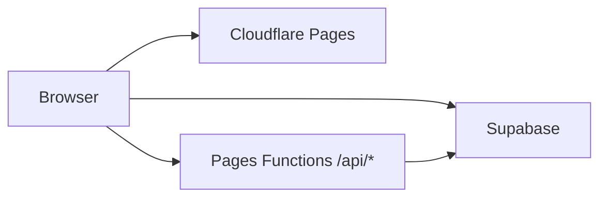

# Sfera VM

Plataforma de pedidos da Sfera Multifranquias para operadores de loja e administradores. Autenticação, criação de pedidos, revisão/aprovação, administração de usuários e consulta de lojas.

Stack: Node.js / Express para desenvolvimento local, Cloudflare Pages com Pages Functions para rota de produção, Supabase (Auth, Database, Storage, RPCs com RLS) como backend de dados.

## Sumário

- [Status do projeto](#3-status-do-projeto)
- [Principais funcionalidades](#4-principais-funcionalidades)
- [Arquitetura](#5-arquitetura)
- [Stack tecnológico](#6-stack-tecnológico)
- [Estrutura do repositório](#7-estrutura-do-repositório)
- [Pré-requisitos](#8-pré-requisitos)
- [Instalação](#9-instalação)
- [Variáveis de ambiente](#10-variáveis-de-ambiente)
- [Desenvolvimento local com Express](#11-desenvolvimento-local-com-express)
- [Preview local com Cloudflare Pages](#12-preview-local-com-cloudflare-pages)
- [Scripts disponíveis](#13-scripts-disponíveis)
- [Testes](#14-testes)
- [Banco de dados e migrations](#15-banco-de-dados-e-migrations)
- [Modelo de segurança](#16-modelo-de-segurança)
- [Rotas de API](#17-rotas-de-api)
- [Rotas da aplicação](#18-rotas-da-aplicação)
- [Deploy Cloudflare Pages](#19-deploy-cloudflare-pages)
- [Configuração do Supabase Auth](#20-configuração-do-supabase-auth)
- [Solução de problemas](#21-solução-de-problemas)
- [Fluxo de desenvolvimento e documentação](#22-fluxo-de-desenvolvimento-e-documentação)
- [Limitações conhecidas](#23-limitações-conhecidas)
- [Licença](#24-licença)

## Status do projeto

| Aspecto | Status |
|---------|--------|
| Servidor Express local | Suportado |
| Frontend estático Cloudflare Pages | Implementado e validado localmente |
| Cloudflare Pages Functions | Implementado e validado localmente |
| Preview local com Wrangler | Requer `.dev.vars` com valores reais |
| Preview remoto Cloudflare | Não validado |
| Deploy em produção | Pendente — não confirmado |

## Principais funcionalidades

- Autenticação com Supabase Auth e restauração de sessão
- Criação de pedidos com rascunho, itens, múltiplas imagens e envio para aprovação
- Revisão administrativa: aprovar, rejeitar, solicitar alterações
- Reenvio de pedidos alterados pelo solicitante
- Ciclo de entrega: pedido realizado e confirmação de recebimento
- Exclusão administrativa de pedidos com reautenticação de senha
- Listagem de pedidos com filtros, resumo, paginação e drawer de detalhes
- Administração de usuários: criar, editar, remover com preservação de identidade histórica
- Remoção suave de usuários (preserva dados históricos, impede novos logins)
- Gerenciamento de lojas
- Painéis responsivos para operadores e administradores

## Arquitetura

A aplicação opera em dois runtimes: Express para desenvolvimento local e Cloudflare Pages para produção. O frontend HTML/CSS/JS é idêntico em ambos. As rotas de API têm implementações separadas com testes de contrato para evitar divergência.

### Desenvolvimento local

```
Browser (http://localhost:3000)
  → Node.js / Express (server.js + src/server/app.js)
  → Supabase (Auth / REST / Storage)
```

### Produção (Cloudflare)

```
Browser
  → Cloudflare Pages (static/)
  → Cloudflare Pages Functions (api/*)
  → Supabase (Auth / REST / Storage / RPC)
```

A maioria das operações de dados utiliza o Supabase diretamente do frontend, protegido por RLS e políticas de Storage. Operações administrativas privilegiadas (gestão de usuários, exclusão de pedidos) permanecem no servidor, usando service-role key.



## Stack tecnológico

| Camada | Tecnologia |
|--------|-----------|
| Frontend | HTML, CSS, JavaScript puro com Tailwind CSS (CDN) |
| Roteamento | History API com shell SPA e partials HTML |
| Ícones | Lucide (CDN) |
| Servidor local | Node.js, Express ^4.19.2 |
| Servidor produção | Cloudflare Pages + Pages Functions |
| Banco de dados | Supabase PostgreSQL com RLS |
| Autenticação | Supabase Auth |
| Armazenamento | Supabase Storage (bucket privado `order-images`) |
| Cliente Supabase | `@supabase/supabase-js` ^2.107.0 (vendado como UMD para produção) |
| Testes unitários/frontend | Node.js (assert nativo) |
| Testes E2E | Playwright ^1.61.0 |
| CLI Supabase | ^2.107.0 (dev) |
| Wrangler | ^4.106.0 (via npx) |

## Estrutura do repositório

```
public/              Frontend estático — HTML, JS, CSS, vendor, _redirects, _headers
functions/           Cloudflare Pages Functions (ESM, Web Crypto)
src/server/          Servidor Express — app.js, rotas, serviços
scripts/             Scripts operacionais — admin, manutenção, smoke tests
supabase/
  migrations/        Migrations incrementais do esquema
  verification/      SQL de verificação somente leitura
  config.toml        Configuração local do Supabase CLI
tests/
  frontend/          Testes de frontend (Node)
  server/            Testes de servidor e testes de contrato
  e2e/               Testes Playwright
.specs/features/     Especificações, design e tarefas de funcionalidades
```

- `public/` contém todo o código entregue ao navegador: `index.html`, partials em `pages/`, scripts em `js/`, estilos em `styles/` e o bundle vendado do Supabase em `vendor/supabase/`.
- `public/_redirects` e `public/_headers` configuram roteamento limpo e cabeçalhos de segurança no Cloudflare Pages.
- `functions/` contém a implementação Pages Functions de `/api/*`, usando Web Crypto e fetch — sem dependências Node exclusivas.
- `src/server/` contém a implementação Express, mantida como runtime de desenvolvimento local.
- `scripts/` inclui criação de admin, verificação de projeto e smoke tests.
- `supabase/migrations/` contém migrations versionadas; não devem ser renomeadas ou reescritas após aplicadas.

## Pré-requisitos

- Node.js 20+ (inferido das dependências)
- npm
- Acesso ao projeto Supabase com URL e chaves válidas
- Wrangler (via npx) para preview Cloudflare Pages, quando aplicável
- Supabase CLI (opcional, para gerenciar migrations)

## Instalação

```bash
git clone <repository-url>
cd sfera-vm-sistema
npm install
```

Crie os arquivos de ambiente a partir dos exemplos:

```bash
cp .env.example .env
cp .env.e2e.example .env.e2e
```

Preencha `.env` e `.env.e2e` com valores reais do projeto Supabase. `.env` e `.env.e2e` estão no `.gitignore` e não devem ser commitados.

## Variáveis de ambiente

### Servidor Express (`.env`)

| Nome | Obrigatório | Segredo | Usado por | Descrição |
|------|-------------|---------|-----------|-----------|
| `PORT` | Não | Não | server.js | Porta do servidor (padrão 3000) |
| `VITE_SUPABASE_URL` | Sim | Não | /api/config, serviços | URL do projeto Supabase |
| `VITE_SUPABASE_ANON_KEY` | Sim | Não | /api/config, serviços | Chave anônima/pública Supabase |
| `SUPABASE_URL` | Sim* | Não | /api/config, serviços | Alias para VITE_SUPABASE_URL |
| `SUPABASE_ANON_KEY` | Sim* | Não | /api/config, serviços | Alias para VITE_SUPABASE_ANON_KEY |
| `SUPABASE_SERVICE_ROLE_KEY` | Sim | Sim | Serviços admin | Chave de service role (nunca expor ao frontend) |

O código aceita `SUPABASE_URL` ou `VITE_SUPABASE_URL` como fallback, e `SUPABASE_ANON_KEY` ou `VITE_SUPABASE_ANON_KEY` como fallback para a chave pública. Pelo menos um par deve estar presente.

### Cloudflare Pages Functions (`.dev.vars`)

| Nome | Obrigatório | Segredo | Descrição |
|------|-------------|---------|-----------|
| `SUPABASE_URL` | Sim | Não | URL do projeto Supabase |
| `SUPABASE_ANON_KEY` | Sim | Não | Chave anônima/pública |
| `SUPABASE_SERVICE_ROLE_KEY` | Sim | Sim | Chave de service role |

O preview local do Wrangler lê estas variáveis de `.dev.vars` (ignorado pelo Git). Em produção, são configuradas no dashboard do Cloudflare Pages.

### Testes E2E (`.env.e2e`)

| Nome | Obrigatório | Segredo | Descrição |
|------|-------------|---------|-----------|
| `E2E_BASE_URL` | Não | Não | URL base (padrão http://127.0.0.1:3000) |
| `E2E_ADMIN_EMAIL` | Sim | Não | Email da conta admin para testes |
| `E2E_ADMIN_PASSWORD` | Sim | Sim | Senha da conta admin |
| `E2E_TEST_USER_PASSWORD` | Sim | Sim | Senha para usuários descartáveis |
| `E2E_TEST_EMAIL_DOMAIN` | Sim | Não | Domínio de email para usuários de teste |
| `E2E_TARGET_ENV` | Sim | Não | Ambiente alvo para mutações. Obrigatório para escritas. Aceito: `local`, `test`, `testing`, `staging`, `preview`. Rejeitado: `production`, `prod`, `live`, vazio, desconhecido. |
| `E2E_ALLOW_LIVE_READS` | Sim | Não | Deve ser exatamente `true` para leituras reais |
| `E2E_ALLOW_LIVE_WRITES` | Sim | Não | Deve ser exatamente `true` para escritas reais |
| `E2E_ALLOW_LIVE_CRUD` | Sim | Não | Deve ser exatamente `true` para CRUD completo |

Os gates `E2E_ALLOW_LIVE_*` protegem contra mutações acidentais em dados reais. Testes que escrevem no Supabase só executam quando as flags apropriadas estão ativadas **e** `E2E_TARGET_ENV` está definido com um valor não-produção. `E2E_TARGET_ENV` por si só não autoriza mutações — é necessário também ativar a flag específica (`E2E_ALLOW_LIVE_WRITES` ou `E2E_ALLOW_LIVE_CRUD`).

> `SUPABASE_SERVICE_ROLE_KEY` não deve ser exposta em `public/`, no JavaScript do frontend, em respostas do navegador, logs, capturas de tela ou arquivos de ambiente commitados.

## Desenvolvimento local com Express

```bash
npm install
npm start
```

O servidor Express inicia em http://localhost:3000 (ou na porta definida por `PORT`). Ele:

- Serve arquivos estáticos de `public/`
- Expõe `/api/config` e `/api/health`
- Expõe rotas administrativas em `/api/admin/users` e `/api/admin/orders`
- Faz fallback de rotas SPA (`/dashboard`, `/login`, etc.) para `public/index.html`
- Requer um arquivo `.env` configurado

Para desenvolvimento com recarga automática:

```bash
npm run dev
```

## Preview local com Cloudflare Pages

O repositório inclui suporte para preview local das Pages Functions:

```bash
cp .dev.vars.example .dev.vars
# Preencha .dev.vars com valores reais do Supabase
npm run preview:pages
```

O Wrangler inicia em http://localhost:8788 servindo:

- Arquivos estáticos de `public/`
- Pages Functions em `functions/api/`
- Rotas limpas via `public/_redirects`

`.dev.vars` está no `.gitignore` e não deve ser commitado.

Esta modalidade não substitui o servidor Express para testes locais. O preview local valida o comportamento das Pages Functions antes do deploy.

## Scripts disponíveis

| Comando | Finalidade | Notas |
|---------|------------|-------|
| `npm start` | Inicia servidor Express | node server.js |
| `npm run dev` | Servidor Express com nodemon | Recarga automática |
| `npm run check` | Validações estáticas | Verifica sintaxe JS e integridade de referências |
| `npm test` | Suíte de testes automatizados | 12 suites (frontend + servidor + contrato) |
| `npm run test:smoke` | Smoke tests via PowerShell | Requer servidor rodando |
| `npm run e2e` | Playwright E2E headless | --workers=1 |
| `npm run test:e2e:headed` | Playwright E2E com navegador visível | --workers=1 --headed |
| `npm run test:e2e:ui` | Playwright UI mode | --workers=1 --ui |
| `npm run validate` | check + test + test:smoke | Validação completa |
| `npm run validate:e2e` | validate + e2e | Validação completa com E2E |
| `npm run preview:pages` | Preview Cloudflare Pages local | wrangler pages dev public --port 8788 |
| `npm run create:admin` | Cria administrador no Supabase | Requer .env configurado |

## Testes

O projeto possui múltiplas camadas de teste:

**Testes de frontend** (Node, sem navegador): validam módulos JS, regras de pedido, roteamento e autenticação.

```bash
node tests/frontend/<nome>.test.js
```

**Testes de servidor**: validam rotas Express, serviço administrativo, fluxo de reenvio e contratos Cloudflare vs Express.

```bash
node tests/server/<nome>.test.js
```

**Smoke tests** (PowerShell): validam disponibilidade básica do servidor.

```bash
npm run test:smoke
```

**Playwright E2E**: testam fluxos completos com navegador real (Microsoft Edge). O Playwright gerencia o ciclo de vida do servidor automaticamente através da configuração `webServer`:

```
command: node server.js
reuseExistingServer: false
```

Não inicie o servidor manualmente antes de executar testes E2E. Não use `npm start &` ou `node server.js &` como fundo — o Playwright inicia e encerra o servidor por conta própria.

Testes que realizam escritas no Supabase real são protegidos por gates de ambiente:

- `E2E_ALLOW_LIVE_READS` — ativa leituras reais
- `E2E_ALLOW_LIVE_WRITES` — ativa escritas reais
- `E2E_ALLOW_LIVE_CRUD` — ativa operações CRUD completas

Nenhum teste destrutivo deve ser executado contra produção.

## Banco de dados e migrations

O esquema do banco é versionado em `supabase/migrations/`. Cada migration é um arquivo SQL incremental com timestamp.

Regras:

- Migrations já aplicadas não devem ser renomeadas ou reescritas
- Novas alterações no banco devem usar migrations incrementais (forward-only)
- O status das migrations pode ser inspecionado com `supabase migration list` (requer Supabase CLI e acesso ao projeto)
- Aplicar migrations: `supabase db push` (remoto) ou `supabase db up` (local)
- O deploy do frontend (Cloudflare Pages) não aplica migrations automaticamente a menos que um workflow separado seja configurado
- SQL de verificação somente leitura está em `supabase/verification/`

## Modelo de segurança

- **RLS (Row-Level Security)**: todas as tabelas da aplicação possuem políticas RLS que restringem acesso com base no perfil do usuário, vínculo com lojas e status ativo.
- **Storage policies**: o bucket `order-images` é privado; upload, download e exclusão são controlados por políticas que verificam permissão do usuário e status do pedido.
- **Active-user enforcement**: toda operação de mutação no banco verifica se o usuário está ativo e não foi removido (`current_user_is_active()`).
- **Autorização administrativa**: operações privilegiadas (gestão de usuários, exclusão de pedidos) exigem papel `ADMIN` validado contra o banco de dados, não apenas o JWT.
- **Isolamento da service-role key**: a `SUPABASE_SERVICE_ROLE_KEY` (que bypassa RLS) é usada exclusivamente no servidor Express ou nas Pages Functions. Nunca é enviada ao navegador.
- **Reautenticação para ações destrutivas**: a exclusão administrativa de pedidos exige reautenticação com a senha do administrador.
- **Remoção suave de usuários**: usuários são desativados operacionalmente (não deletados fisicamente). O perfil permanece no banco com `is_active=false`, `removed_at` e `removed_by_id`. Chaves estrangeiras históricas (pedidos, imagens, auditoria) permanecem intactas.
- **Chave anônima (anon key)**: é segura para uso público quando protegida por RLS e políticas de Storage corretas. A service-role key é secreta e bypassa todas as políticas.

## Rotas de API

### Públicas

| Método | Rota | Finalidade | Autenticação |
|--------|------|-----------|--------------|
| GET | `/api/config` | Retorna URL e chave pública do Supabase | Nenhuma (pública) |
| GET | `/api/health` | Healthcheck do servidor | Nenhuma (pública) |

### Administrativas (privilegiadas)

| Método | Rota | Finalidade | Autenticação |
|--------|------|-----------|--------------|
| GET | `/api/admin/users` | Listagem paginada de usuários | Bearer token de admin ativo |
| POST | `/api/admin/users` | Criar novo usuário | Bearer token de admin ativo |
| PATCH | `/api/admin/users/:id` | Atualizar dados de usuário | Bearer token de admin ativo |
| DELETE | `/api/admin/users/:id` | Remover usuário (desativação) | Bearer token de admin ativo |
| DELETE | `/api/admin/orders/:id` | Excluir pedido e imagens | Bearer token + senha do admin |

As mesmas rotas são implementadas no Express (local) e nas Cloudflare Pages Functions (produção), com testes de contrato preservando equivalência.

## Rotas da aplicação

A aplicação é um shell SPA que carrega partials HTML dinamicamente via History API.

| Rota | Acesso | Descrição |
|------|--------|-----------|
| `/` | Público | Redireciona conforme autenticação |
| `/login` | Público | Tela de login |
| `/dashboard` | Autenticado | Painel principal |
| `/pedidos` | Autenticado + permissão | Lista de pedidos com filtros e drawer |
| `/novo-pedido` | Autenticado + permissão | Formulário de criação/edição de pedido |
| `/lojas` | Autenticado + permissão | Gerenciamento de lojas |
| `/usuarios` | ADMIN apenas | Administração de usuários |

Suporte a rotas limpas no Cloudflare Pages é fornecido por `public/_redirects`, que reescreve cada rota para `/index.html` com status 200.

## Deploy Cloudflare Pages

As configurações pretendidas para o projeto no Cloudflare Dashboard:

| Parâmetro | Valor |
|-----------|-------|
| Framework preset | None |
| Root directory | Raiz do repositório |
| Build command | `exit 0` |
| Build output directory | `public` |
| Production branch | `main` |

Observações:

- A integração com GitHub pode implantar automaticamente a branch `main` e criar previews de outras branches
- As variáveis de ambiente do runtime (`SUPABASE_URL`, `SUPABASE_ANON_KEY`, `SUPABASE_SERVICE_ROLE_KEY`) devem ser configuradas no dashboard do Cloudflare Pages
- URLs de redirecionamento do Supabase Auth devem ser atualizadas separadamente no dashboard do Supabase
- Nenhum deploy de produção foi confirmado até o momento

## Configuração do Supabase Auth

Para que a autenticação funcione corretamente em todos os ambientes, as seguintes URLs devem ser configuradas no dashboard do Supabase (Authentication → Settings):

- **Site URL**: produção
- **Redirect URLs**: URLs de produção, preview Cloudflare, Express local (`http://localhost:3000`) e Wrangler local (`http://localhost:8788`)

Uma interface completa de recuperação/redo de senha não foi implementada e permanece como limitação conhecida.

## Solução de problemas

### Porta 3000 já em uso

```bash
powershell.exe -NoProfile -Command '$processIds = Get-NetTCPConnection -LocalPort 3000 -State Listen -ErrorAction SilentlyContinue | Select-Object -ExpandProperty OwningProcess -Unique | Where-Object { $_ -gt 0 }; foreach ($processId in $processIds) { Stop-Process -Id $processId -Force }'
```

### Playwright deixa processo servidor órfão no Windows

A configuração `webServer` no Playwright deve usar `node server.js` em vez de `npm start`, porque `npm.cmd` pode deixar um processo Node filho vivo após o término dos testes.

### `/api/config` indisponível

Verificar se:

- O arquivo `.env` (Express) ou `.dev.vars` (Pages Functions) existe com valores reais
- As variáveis `SUPABASE_URL` e `SUPABASE_ANON_KEY` estão preenchidas corretamente
- No navegador, a rota `/api/config` retorna um JSON com `supabaseUrl` e `supabaseAnonKey`

### Rota direta retorna 404 no Cloudflare Pages

Verificar se a rota está incluída em `public/_redirects`. O arquivo deve conter uma entrada no formato:

```
/<rota>    /index.html    200
```

### Pages Function retorna erro de configuração

Verificar as variáveis de ambiente configuradas no dashboard do Cloudflare Pages (produção) ou no arquivo `.dev.vars` (preview local). A function requer `SUPABASE_URL`, `SUPABASE_ANON_KEY` e `SUPABASE_SERVICE_ROLE_KEY`.

## Fluxo de desenvolvimento e documentação

- Não commitar segredos, tokens ou chaves
- Não reescrever migrations já aplicadas
- Executar `npm run validate` antes de commitar
- Manter especificações de funcionalidades sincronizadas com o código implementado
- Commits devem ser focados e atômicos
- Testes E2E destrutivos exigem autorização explícita e ambiente controlado

## Limitações conhecidas

- Preview remoto no Cloudflare Pages não foi validado
- Deploy em produção não foi realizado
- Interface completa de recuperação/redo de senha não foi implementada
- Interface de reativação de usuários removidos está fora do escopo atual
- Testes E2E destrutivos requerem ambiente controlado com flags `E2E_ALLOW_LIVE_*` ativadas

## Licença

Projeto de uso interno. Consulte os responsáveis pelo repositório para informações sobre licenciamento, distribuição e uso externo.
